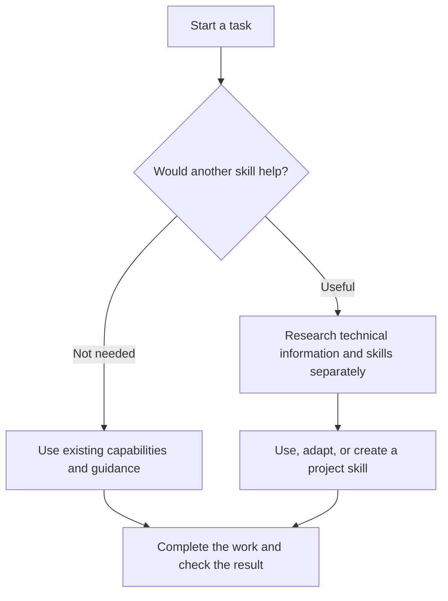

<p align="center">
  
</p>

<h1 align="center">OneForAll</h1>
<p align="center"><a href="README.md">English</a> | <a href="README.th.md">ภาษาไทย</a></p>
<p align="center">Help your agent work efficiently on every task, and discover and adapt skills for the project you're working on.</p>

<p align="center">
  <a href="docs/setup.md">Setup guide</a> ·
  <a href="skills/oneforall/SKILL.md">Skill source</a> ·
  <a href="docs/verification.md">Testing notes</a>
</p>

Someone may already have written a skill for the problem you're working on. Finding it, then deciding whether it fits your codebase, takes time.

**OneForAll** helps your agent with that. When you start a fix or build something new, it considers whether an existing skill could make the work easier. When further research would help, it looks for relevant techniques and skills, adapts them to your project, and saves useful procedures for later tasks.

If the agent already has what it needs, it gets on with the work. Routine tasks don't need another search, and ordinary conversations shouldn't turn into discussions about skills.

## Getting started

Install through Vercel's [Skills CLI](https://github.com/vercel-labs/skills). You'll need Node.js/npm and Git. Choose the command for your agent:

```sh
# Codex
npx skills add thefogusz/OneForAll --skill oneforall head-chef --agent codex --global

# Claude Code
npx skills add thefogusz/OneForAll --skill oneforall head-chef --agent claude-code --global
```

Then invoke it with a task:

```text
Codex:       $oneforall Fix this project's export so it handles Thai text correctly.
Claude Code: /oneforall Fix this project's export so it handles Thai text correctly.
```

To let your agent decide when to use OneForAll across projects, add the [automatic-use instructions](docs/setup.md#enable-automatic-use) once. Start a new session if a newly installed skill isn't visible yet.

The [setup guide](docs/setup.md) also covers manual installation, installation for a single project, and other agents.

## How it works

OneForAll starts with the task and the guidance already available in the project. If those are sufficient, the agent uses them directly. It researches further when a specialist technique or workflow could help, for example with repetitive manual work, unfamiliar tools, or a problem that keeps resisting a fix.

When research is warranted, it follows two separate tracks:

- **Technical research:** read primary documentation and compare it with the project's tools, versions, and requirements.
- **Skill research:** check available skills, skills.sh, and source repositories, then read promising skills before choosing an approach.

A suitable existing skill can be used as it is. Useful techniques from several sources can be adapted to the project. If no skill fits but the research produces a procedure worth reusing, OneForAll can write a project skill from those findings.



The task you asked for remains the priority. Skills are created or updated only when there is something useful to retain, and untested guidance is kept distinct from verified results.

You can also request discovery directly: "Which skills could help reduce repetitive work in this project?"

## Work principles

Beyond finding skills, OneForAll gives the agent eight short principles for every substantive task, adapted from [Superpowers](https://github.com/obra/superpowers) and [Ponytail](https://github.com/dietrichgebert/ponytail):

1. Understand before acting: read what the change touches and list every place it must reach.
2. Smallest complete solution: reuse what the project already has (code, components, project skills) before writing anything new.
3. Never cut validation, data-loss handling, security, accessibility, or what you asked for.
4. Find the root cause before fixing; after two failed fixes, rethink instead of patching.
5. Leave one small test for logic that can break.
6. Plan multi-step work as small steps that each end in a check.
7. Claim "done" only after running the check, and say what wasn't verified.
8. Mark deliberate shortcuts in code so they can be found later.

If you already use Superpowers or Ponytail, their full skills still apply; OneForAll follows them for the detail and doesn't duplicate them. Sources and what was adopted from each: [work principles](skills/oneforall/references/work-principles.md).

## Companion skill: head-chef

This repository ships a second skill, [head-chef](skills/head-chef/SKILL.md), for the cost side of the same goal: every project gets the skills that fit it, and every recurring job runs on the cheapest model that does it well. The two are independent and can be installed together or separately.

When a task builds or audits something that calls a model over and over (a scheduled job, a pipeline, a multi-agent workflow), head-chef has the strongest model write the recipe once. Each step then runs on the cheapest station that can do it: plain code, an optional classifier, then small, mid, and strong models. A cheaper model replaces the current one only after replaying real past inputs, the change ships as a switch that can be reversed, and a small weekly sample checks that quality holds. Each job's recipe is saved as a project skill, like the skills OneForAll creates, so it stays with that project. If OneForAll sees such a job and head-chef isn't installed, it may suggest it.

head-chef names no models. Each time, it reads the models the host currently offers, ranks them by price and the vendor's own positioning, and assigns the tiers from that ranking, so it keeps working after Claude or Codex ship new models. A new model triggers a replay check before a job switches to it. For review, it checks whether the other family's CLI (Codex or Claude Code) is installed and signed in, and offers to use it; it never installs or signs in on its own. If none is connected or you decline, it creates a fresh reviewer agent that sees only the output and the checks.

## Skill recommendations

During research, OneForAll may find a third-party skill worth adding to the project. It can suggest it with a source link, the reason it would help, and any required tools or costs. Usually one recommendation is enough; it may offer up to three when there are useful alternatives.

Installing a third-party skill waits for your choice. The main task continues in the meantime, including any useful project skills OneForAll can write from the research.

## Project skills

OneForAll is the shared controller. The knowledge it develops while working stays in the project. For example, in Codex:

```text
project-a/
└── .agents/skills/
    └── project-a-csv-export/
        └── SKILL.md

project-b/
└── .agents/skills/
    └── project-b-api-checks/
        └── SKILL.md
```

When you switch projects, it assesses the new project's code, tools, and requirements. Each project keeps its own guidance.

New skills go in `.agents/skills/` for Codex or `.claude/skills/` for Claude Code. OneForAll checks both locations before creating a skill. If a suitable one already exists, it reads that file directly, even when you have changed agents.

Skills managed by OneForAll carry `metadata.oneforall-managed: "true"` so they can be maintained over time. Skills you wrote yourself are used as they are unless you ask for changes.

## Compatibility and testing

| Agent | Status |
| --- | --- |
| Codex | Installation and sample tasks tested. |
| Claude Code | Installation tested and setup checked against official documentation. Execution in Claude Code has not been tested. |
| Other Agent Skills clients | Guidance for adapting paths and invocation is included. Individual clients have not been tested. |

OneForAll is a set of instructions in `SKILL.md` that uses the agent's existing tools. Automatic use depends on the agent and its configuration. See the [testing notes](docs/verification.md) for the scope of each check.

Research needs the agent's web tools. If access is unavailable, the agent should say so and work only from evidence it can verify. Model and tool costs follow your existing services; OneForAll requires no background service or additional API subscription.

## Design sources

OneForAll adapts working principles from [Superpowers](https://github.com/obra/superpowers) and [Ponytail](https://github.com/dietrichgebert/ponytail), and draws on skill discovery from [Vercel find-skills](https://github.com/vercel-labs/skills/blob/main/skills/find-skills/SKILL.md), reusable lessons from [AutoSkill](https://github.com/ECNU-ICALK/AutoSkill), and skill-authoring guidance from [OpenAI](https://github.com/openai/skills) and [Anthropic](https://github.com/anthropics/skills/blob/main/skills/skill-creator/SKILL.md).

These ideas inform OneForAll's workflow; you don't need to install all of those projects. Details are in the [research references](skills/oneforall/references/research-sources.md). The logo was generated with AI.

## Reporting issues

If OneForAll activates at the wrong time, creates duplicate skills, or saves guidance that doesn't work, please [open an issue](https://github.com/thefogusz/OneForAll/issues) with the task, agent, and observed result. Remove private information before sharing examples.
