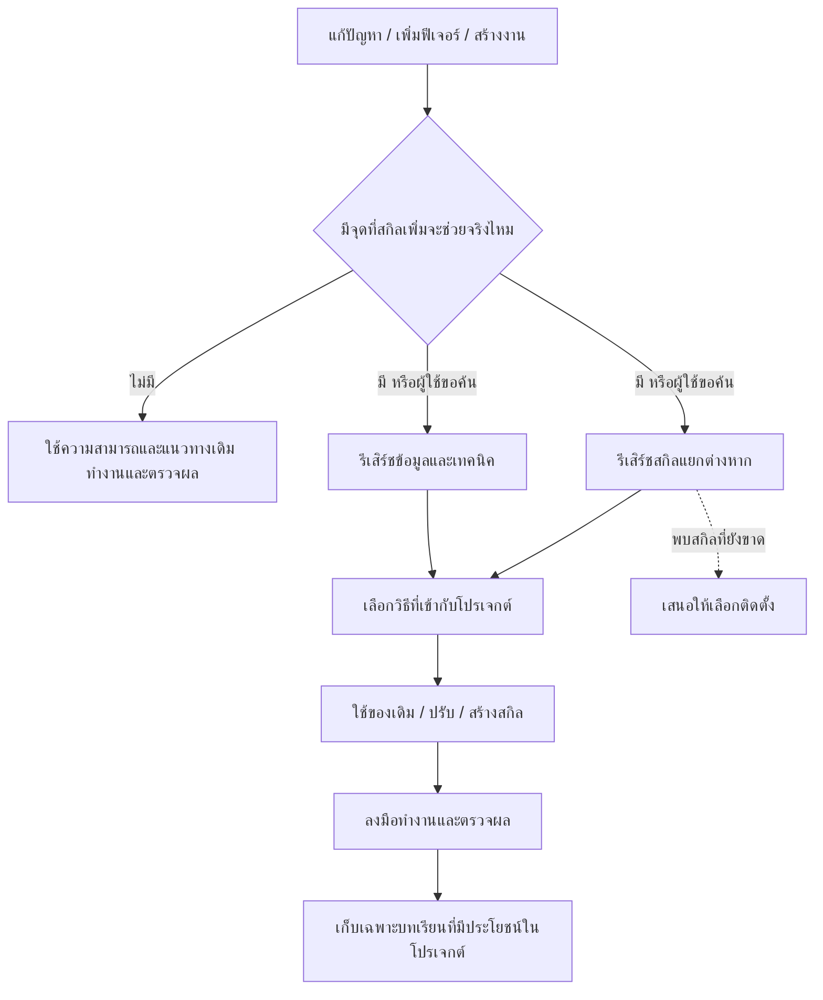

<p align="center">
  
</p>

<h1 align="center">OneForAll</h1>

<p align="center"><strong>ของดีมีคนทำไว้แล้ว แค่คุณยังไม่รู้ว่ามันอยู่ไหน.</strong></p>
<p align="center">Find what helps. Skip the noise. Keep moving.</p>

<p align="center">
  <a href="docs/setup.md">ติดตั้ง & เปิดโหมดอัตโนมัติ</a> ·
  <a href="skills/oneforall/SKILL.md">อ่านตัวสกิล</a> ·
  <a href="docs/verification.md">ดูหลักฐานการตรวจ</a>
</p>

---

คุณมีงานให้ทำ ไม่ได้สมัครมาเป็นผู้จัดการสกิลเต็มเวลา

**OneForAll** ช่วย agent ค้นพบสกิลและวิธีทำงานที่มีคนแก้ปัญหาไว้แล้ว โดยดูว่ามันช่วยโปรเจกต์คุณตรงไหนจริง ๆ งานที่ agent ทำได้อยู่แล้วก็ทำเลย เมื่อเจอจุดที่ความรู้เฉพาะทางหรือ workflow สำเร็จรูปช่วยลดงานได้ ค่อยรีเสิร์ชข้อมูลและสกิลแยกกัน แล้วเก็บวิธีที่ใช้ซ้ำได้เป็นสกิลของโปรเจกต์

Agent เก่งอยู่แล้ว สกิลมีไว้เสริมทัพ จะเปลี่ยนข้อความบนปุ่มก็ไม่ต้องเรียกประชุมสมาคมสกิลโลก

รองรับการวางไฟล์และคำสั่งเรียกของ **Codex** กับ **Claude Code** ใช้ `SKILL.md` มาตรฐานเดียวกัน ส่วน agent อื่นที่รองรับ Agent Skills มีแนวทางติดตั้งและโหลดไฟล์ให้ด้วย ดู [ระดับการตรวจจริง](docs/verification.md) ก่อนนับว่ารองรับทุกอย่างในจักรวาล

## จาก “ทำไงดี” ไปถึง “มีวิธีแล้ว”



**เส้นหลักเดินต่อเอง เส้นประให้เลือกได้** การเสนอแพ็กเกจหรือสกิลเพิ่มไม่ทำให้งานหยุดรอ คุณไม่เลือก มันก็ยังต้องทำงานที่คุณสั่ง

## มีอะไรอยู่ในหมัดนี้

| เรื่อง | OneForAll ทำอะไร |
| --- | --- |
| ทำได้อยู่แล้ว | ทำงานต่อ ไม่ค้นเพิ่ม ไม่สร้างไฟล์ให้รก ไม่รายงานเรื่องสกิลทุกครั้ง |
| ค้นข้อมูล | อ่านเอกสารต้นทางและเทคนิคที่ตรงกับเวอร์ชันของโปรเจกต์ |
| ค้นสกิล | ค้นแยกจากข้อมูล ผ่านสกิลในเครื่อง, skills.sh และ source repositories |
| เจอสกิลที่เหมาะ | นำวิธีที่เกี่ยวข้องมาปรับให้เข้ากับไฟล์ เครื่องมือ และข้อกำหนดจริง |
| หาไม่เจอ | สร้างจากข้อมูลและหลักฐานในโปรเจกต์ เฉพาะเมื่อมีวิธีที่ควรเก็บใช้ซ้ำ |
| มีของเดิมแล้ว | ใช้หรือปรับจุดที่ขาด ไม่เปิดโรงงานผลิตสกิลชื่อคล้ายกัน 17 ตัว |
| เปลี่ยนโปรเจกต์ | อ่านบริบทใหม่ เก็บความรู้ในโปรเจกต์ใหม่ |
| สลับ agent | ตรวจทั้ง `.agents/skills/` และ `.claude/skills/` แล้วใช้ไฟล์เดิมเมื่อมันตรงงาน |
| เห็นช่องว่าง | ปกติเสนอตัวที่เหมาะที่สุดตัวเดียว สูงสุด 3 ตัวเมื่อมีทางเลือกจริง พร้อมลิงก์ ประโยชน์ และสิ่งที่ต้องใช้ |

**ประเมินเงียบ ๆ ก่อนเริ่มงาน ไม่ได้ค้นทุกงาน** ใช้สกิลเดิมที่ตรงงานได้ทันที ไม่ต้องสำรวจใหม่เพราะเปิดโปรเจกต์อีกครั้ง ส่วนการคุยเล่น ถามความคืบหน้า หรือพิมพ์ “โอเค” ไม่ใช่สัญญาณให้ส่งทีมสำรวจอินเทอร์เน็ต

ควรค้นเมื่อเจอเทคนิคเฉพาะที่ยังไม่ชัด แก้ซ้ำแล้วไม่ผ่าน งานมือที่เกิดซ้ำ หรือมีเหตุผลว่าสกิลสำเร็จรูปจะช่วยลดเวลาและข้อผิดพลาดได้ ไม่ต้องรอจน agent ทำไม่ได้ แต่ก็ไม่ค้นเพียงเพราะงานชื่อ “เพิ่มฟีเจอร์” การตรวจเอกสารล่าสุดตามปกติยังทำได้โดยไม่ต้องพ่วงการหาสกิลทุกครั้ง

## ติดตั้งแล้วลองต่อยโจทย์แรก

ใช้ [Skills CLI ของ Vercel](https://github.com/vercel-labs/skills) ผ่าน Node.js/npm:

```sh
# Codex
npx skills add thefogusz/OneForAll --skill oneforall --agent codex --global

# Claude Code
npx skills add thefogusz/OneForAll --skill oneforall --agent claude-code --global
```

เลือกคำสั่งให้ตรงกับ agent ที่ใช้ จากนั้นเปิด session ใหม่ถ้าสกิลยังไม่แสดง:

```text
Codex:       $oneforall แก้ระบบ export ให้รองรับข้อมูลภาษาไทยในโปรเจกต์นี้
Claude Code: /oneforall แก้ระบบ export ให้รองรับข้อมูลภาษาไทยในโปรเจกต์นี้
```

การเรียก OneForAll เพื่อทำงานเป็นการให้มันดูแลสกิลที่มันสร้างในโปรเจกต์ด้วย ตามขอบเขตและสิทธิ์ของงานนั้น

**อยากให้ช่วยดูให้ทุกโปรเจกต์?** เพิ่ม [คำสั่งเปิดโหมดอัตโนมัติ](docs/setup.md#เปิดโหมดอัตโนมัติ) อีกครั้งเดียว เพื่อให้ agent ประเมินว่าควรหยิบ OneForAll มาช่วยเมื่อไร โดยไม่ต้องเรียกชื่อเองทุกงาน

มีวิธีติดตั้งด้วยไฟล์โดยไม่ใช้ Node.js และวิธีเลือก agent อื่นใน [คู่มือติดตั้ง](docs/setup.md)

## ความรู้ของใคร อยู่บ้านคนนั้น

ตัวอย่างเมื่อใช้ Codex:

```text
personal skills/
└── oneforall/                  ← สกิลกลาง

project-a/
└── .agents/skills/
    └── project-a-csv-export/    ← วิธีทำงานของ A

project-b/
└── .agents/skills/
    └── project-b-api-checks/    ← วิธีทำงานของ B
```

เมื่อ Claude Code สร้างสกิลใหม่จะใช้ `.claude/skills/` แต่ OneForAll ตรวจทั้งสองตำแหน่งก่อนเสมอ ถ้ามีสกิลที่ตรงงานอยู่แล้วจะอ่านไฟล์นั้นตรง ๆ ไม่สร้างสำเนาเพียงเพราะเปลี่ยน agent การอ่านตรงนี้เป็นหน้าที่ของ OneForAll ไม่ได้หมายความว่า agent ทุกตัวค้นพบทุกโฟลเดอร์เอง

สกิลที่ดูแลอัตโนมัติมีเครื่องหมายนี้:

```yaml
metadata:
  oneforall-managed: "true"
```

ไฟล์ที่คุณเขียนเองยังอยู่ในมือคุณ จะไม่ถูกแก้เพียงเพราะมีสกิลกลางผ่านมาเห็น

## มันฉลาดขึ้นได้ แต่ขอหลักฐานด้วย

สกิลใหม่เก็บสิ่งที่ช่วยทำงานจริง: ขอบเขตโปรเจกต์ วิธีทำ จุดพลาดที่เจอ วิธีตรวจ และแหล่งข้อมูล/แหล่งสกิลแยกกัน สิ่งที่เพิ่งอ่านมาให้เขียนว่า “รีเสิร์ชแล้ว” สิ่งที่ทดสอบผ่านแล้วค่อยเขียนว่า “ทดสอบแล้ว”

ค้นเว็บไม่ได้ก็บอกว่าค้นไม่ได้ ไม่เปิดโหมดนักแต่งบรรณานุกรม และไม่ส่ง source ส่วนตัวหรือข้อมูลลูกค้าออกไปเป็นคำค้น

ตัวนี้เป็น **คำสั่งและไฟล์ความรู้สำหรับ agent** ใช้เครื่องมือกับสิทธิ์ที่ agent มีอยู่ ต้องมีเครื่องมือค้นเว็บเพื่อทำรีเสิร์ชครบ ไม่มี daemon หรือ API subscription เพิ่มที่ OneForAll บังคับ แต่การใช้งานโมเดลและเครื่องมือยังมีต้นทุนตามบริการของคุณ

## ตรวจอะไรแล้วบ้าง

- รุ่นปัจจุบันทดลองแก้คำผิดในโปรเจกต์จำลอง: แก้ตรง ๆ ไม่ค้นเว็บและไม่สร้างสกิลเพิ่ม
- รุ่นก่อนหน้าทดลองกับสองโปรเจกต์ที่ export คนละรูปแบบ: สร้างสกิลแยก และแก้จนเทสต์ผ่าน
- ตรวจแพ็กเกจ ชื่อ ลิงก์ และ metadata พร้อมแยกสถานะการตรวจของแต่ละ agent ใน [บันทึกการตรวจ](docs/verification.md)
- มี [โจทย์สำหรับทดสอบพฤติกรรมต่อ](docs/verification.md#ทดสอบพฤติกรรมรอบถัดไป) รวมถึงการสลับ agent และคำแนะนำที่ต้องไม่ขวางงาน

การเรียกอัตโนมัติยังอาศัย agent ทำตามคำสั่ง ไม่ใช่โปรแกรมดักทุกข้อความ **ชื่อ OneForAll ไม่ใช่ประกัน AllWillWork™**

## ยืมวิธีคิด ไม่ยกบ้านใครมาทั้งหลัง

รวมแนวทางจาก [Vercel find-skills](https://github.com/vercel-labs/skills/blob/main/skills/find-skills/SKILL.md), [AutoSkill](https://github.com/ECNU-ICALK/AutoSkill), [OpenAI skills](https://github.com/openai/skills) และ [Anthropic skill-creator](https://github.com/anthropics/skills/blob/main/skills/skill-creator/SKILL.md) เป็นขั้นตอนของ OneForAll โดยมีที่มาใน [research-sources.md](skills/oneforall/references/research-sources.md)

ไม่ต้องติดตั้งโครงการเหล่านั้นทั้งหมด และไม่ได้อ้างว่าเป็นผลิตภัณฑ์ของเจ้าของแหล่งอ้างอิง โลโก้สร้างด้วย AI และถูกปรับให้อยู่ในแนวหมัดขาวดำเรียบ ๆ พร้อมประกายสายฟ้า

พบว่ามันเก็บบทเรียนผิดหรือสร้างสกิลรก? [เปิด issue](https://github.com/thefogusz/OneForAll/issues) พร้อมโจทย์, agent/เวอร์ชัน, ผลที่คาดหวัง และตัวอย่างที่ลบข้อมูลส่วนตัวแล้ว ความขี้เกียจพัฒนาได้ ถ้ามีหลักฐาน
