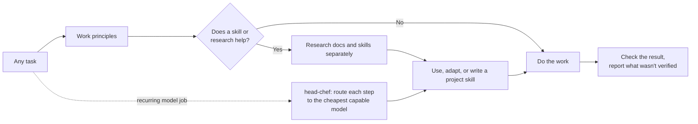

<p align="center">
  
</p>

<h1 align="center">OneForAll</h1>
<p align="center"><a href="README.md">English</a> | <a href="README.th.md">ภาษาไทย</a></p>
<p align="center"><strong>One set of working rules for every task. Skills that belong to each project. The right model for each step.</strong></p>

<p align="center">
  
  
  
</p>

<p align="center">
  <a href="#quick-start">Quick start</a> ·
  <a href="docs/setup.md">Setup guide</a> ·
  <a href="skills/oneforall/SKILL.md">OneForAll source</a> ·
  <a href="skills/head-chef/SKILL.md">head-chef source</a> ·
  <a href="docs/verification.md">Testing notes</a>
</p>

---

Coding agents are capable, but they waste effort in predictable ways: they rebuild what the project already has, claim "fixed" without checking, search for skills they don't need, and run the most expensive model on work a script could do.

OneForAll is a pair of [Agent Skills](https://agentskills.io/specification) that close those gaps for any kind of project work: code, documents, video, design, data, research, and operations.

| Skill | What it gives your agent |
| --- | --- |
| **[oneforall](skills/oneforall/SKILL.md)** | **Eight work principles** for every task, and **project-scoped skill discovery**: find, adapt, or write a skill only when it removes a real difficulty, and keep it in that project. |
| **[head-chef](skills/head-chef/SKILL.md)** | **Model routing** for recurring jobs: the strongest model writes the recipe once, code and cheaper models run it every time, and every downgrade is proven on real past inputs. |

The two are independent. Install both, or only the one you need.

## Quick start

You'll need Node.js/npm and Git.

```sh
# Claude Code and Codex together
npx skills add thefogusz/OneForAll --skill oneforall head-chef --agent claude-code codex --global
```

On Windows PowerShell, use `npx.cmd` if script execution is disabled. Then give your agent a task:

```text
Claude Code: /oneforall Fix this project's export so it handles Thai text correctly.
Codex:       $oneforall Fix this project's export so it handles Thai text correctly.
```

To have the agent apply OneForAll on its own, add the [automatic-use block](docs/setup.md#enable-automatic-use) to your personal instructions once. The [setup guide](docs/setup.md) covers single-project installs, manual installs, and other agents.

## How it fits together



The installed skills are shared across all your projects. What they learn is not: each project's skills live in that project's own `.claude/skills/` or `.agents/skills/` folder.

```text
~/.claude/skills/  or  ~/.agents/skills/      installed once, shared
├── oneforall/
└── head-chef/

video-project/.claude/skills/                  belongs to this project only
├── video-project-catcut-export/
└── video-project-nightly-render/              a head-chef recipe card

web-app/.agents/skills/
└── web-app-api-checks/
```

## Work principles

Every substantive task follows eight short principles, adapted from [Superpowers](https://github.com/obra/superpowers) and [Ponytail](https://github.com/dietrichgebert/ponytail):

| # | Principle | In practice |
| --- | --- | --- |
| 1 | **Understand before acting** | Read what the change touches, including the project's own skills, and list every place it must reach. |
| 2 | **Smallest complete solution** | Reuse what exists (code, templates, presets, project skills) before making anything new. Small is not partial. |
| 3 | **Never cut** | Validation, data-loss protection, security, privacy, accessibility, licensing, or what you asked for. |
| 4 | **Root cause before fixes** | Fix it once at the source. After two failed fixes, rethink instead of patching. |
| 5 | **Check what can break, and keep the check** | Money or branching logic leaves a test file behind, even when the project has no test suite yet. |
| 6 | **Small verifiable steps** | Multi-step work is split into steps that each end in a check. |
| 7 | **Evidence before claims** | "Done" only after the check has run in this session; anything unverified is named. |
| 8 | **Mark deliberate shortcuts** | Each with its limit and when to revisit it. |

What counts as a check depends on the work: a test for code, running every documented command for docs, opening rendered frames for video, reconciling totals for data, opening primary sources for research. The full table is in the [skill](skills/oneforall/SKILL.md#work-principles-for-every-task).

Already using Superpowers or Ponytail? Their full skills still apply, and the stricter rule wins. [What was adopted from each, and why](skills/oneforall/references/work-principles.md).

## Project skills, only when they earn it

Someone may already have written a skill for your problem. OneForAll checks, but only when that could actually help: an unfamiliar tool, repetitive manual work, or a problem that keeps resisting a fix. Routine tasks go straight to the work.

When research is warranted, it runs two separate tracks:

- **Technical research:** primary documentation, compared with the project's actual versions and tools.
- **Skill research:** local skills, [skills.sh](https://skills.sh/), and source repositories, read before choosing.

A fitting skill is used as it is. Otherwise OneForAll writes a short project skill from the findings, but only after naming the concrete failure the skill prevents, and it validates the file before reporting it. Third-party skills are suggested, never installed without your choice. Skills it manages carry `metadata.oneforall-managed: "true"`; skills you wrote are left as they are.

## head-chef: the right model for each step

For jobs that call a model again and again (scheduled jobs, pipelines, multi-agent workflows):

```text
code  →  classifier (optional)  →  small model  →  mid model  →  strong model
          stop at the first station that can do the step
```

- **No hardcoded models.** It reads what the host offers today, ranks by price and the vendor's positioning, and assigns tiers from that, so it keeps working when Claude or Codex ship new models.
- **Proven downgrades.** A cheaper model takes over a step only after replaying real past inputs and matching the current model's own consistency.
- **Guardrails.** Budget caps, a kill switch, an escalation log, and a weekly sample review after shipping.
- **Independent review.** It checks whether the other family's CLI (Codex or Claude Code) is installed and signed in and offers it; otherwise a fresh reviewer agent sees only the output and the checks.

## Tested on six kinds of work

Independent agents were given both skills and a task with a hidden trap, without being told what was being tested. On 2026-10-29:

| Work | Trap | Result |
| --- | --- | --- |
| Code bug | Wrong discount used by two callers | ✅ Fixed once in the shared function; test file seen failing, then passing *(second run, after a fix to the skill)* |
| Documentation | Old script name repeated in the FAQ | ✅ Both places fixed; the documented command was run |
| Video | Brief for a 6-second 720p teaser | ✅ Source kept; duration, size, and audio probed; frames opened and viewed *(second run)* |
| Data | A duplicate order and a blank amount | ✅ Both found and reported with their effect on the totals; no numbers from the model |
| Quick question | "What does this project do?" | ✅ Answered directly, with no files, searches, or skill talk |
| Recurring job | A nightly digest sending everything to the top model | ✅ Code-first routing card with budget, kill switch, and replay plan; skill file validated *(second run)* |

The first run exposed four weak spots: no lasting test, frames not viewed, an invalid skill file, and an unresolved model list. All four were fixed in the skills, and the affected tasks were re-run. Details and limits: [testing notes](docs/verification.md).

## Compatibility

| Agent | Status |
| --- | --- |
| Claude Code | Installation tested. Six task types exercised by agents following the skills. Native auto-invocation not yet observed end to end. |
| Codex | Installation and sample tasks tested. |
| Other Agent Skills clients | Path and invocation guidance included; not tested. |

No background service or extra API subscription is needed. Research uses your agent's existing web tools; if they're unavailable, the agent says so and works from what it can verify.

## Credits

Working principles adapted from [Superpowers](https://github.com/obra/superpowers) by Jesse Vincent and [Ponytail](https://github.com/dietrichgebert/ponytail) by DietrichGebert (both MIT). Skill discovery draws on [Vercel find-skills](https://github.com/vercel-labs/skills/blob/main/skills/find-skills/SKILL.md) and [AutoSkill](https://github.com/ECNU-ICALK/AutoSkill); skill authoring on [OpenAI](https://github.com/openai/skills) and [Anthropic](https://github.com/anthropics/skills/blob/main/skills/skill-creator/SKILL.md) guidance. None of them needs to be installed. [Research references](skills/oneforall/references/research-sources.md). The logo was generated with AI.

## Reporting issues

If a skill activates at the wrong time, creates duplicate skills, or saves guidance that doesn't work, please [open an issue](https://github.com/thefogusz/OneForAll/issues) with the task, agent, and what happened. Remove private information first.
