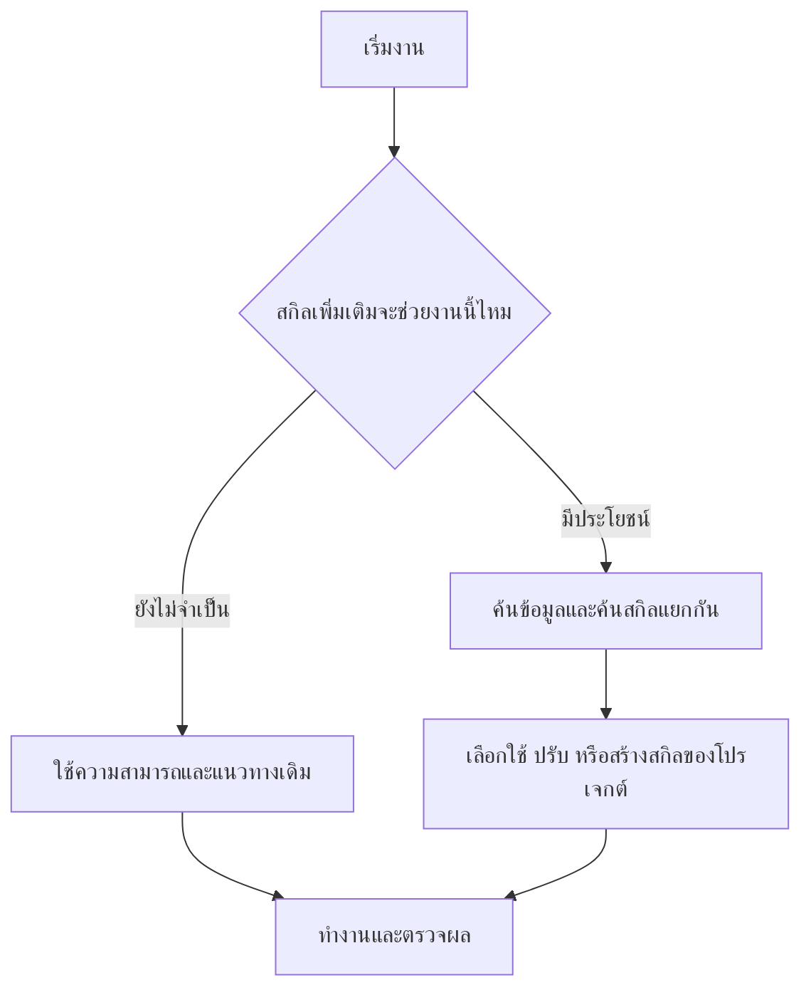

<p align="center">
  
</p>

<h1 align="center">OneForAll</h1>
<p align="center"><a href="README.md">English</a> | <a href="README.th.md">ภาษาไทย</a></p>
<p align="center">ช่วย agent ค้นหาและปรับสกิลให้เหมาะกับโปรเจกต์ที่คุณกำลังทำ</p>

<p align="center">
  <a href="docs/setup.th.md">คู่มือติดตั้ง</a> ·
  <a href="skills/oneforall/SKILL.md">ตัวสกิล</a> ·
  <a href="docs/verification.th.md">ผลทดสอบ</a>
</p>

หลายปัญหาที่เราเจอตอนทำโปรเจกต์ มีคนเขียนสกิลหรือขั้นตอนแก้ไว้แล้ว แต่เราอาจไม่รู้ว่ามี หรือไม่มีเวลาไปไล่หาว่าตัวไหนเหมาะกับงานของเรา

**OneForAll** ทำขึ้นมาเพื่อช่วยตรงนี้ เมื่อคุณเริ่มแก้ปัญหาหรือสร้างอะไรใหม่ มันจะช่วย agent ดูว่ามีสกิลที่ทำให้งานง่ายขึ้นได้ไหม ถ้ามี ก็ค้นและนำวิธีที่เกี่ยวข้องมาปรับใช้กับโปรเจกต์ พร้อมเก็บเป็นสกิลสำหรับใช้ต่อในงานครั้งถัดไป

งานที่ agent ทำได้อยู่แล้วก็ทำต่อได้เลย ไม่จำเป็นต้องค้นเพิ่มทุกครั้ง และไม่ควรมีเรื่องสกิลมาขัดจังหวะการคุยตามปกติ

## เริ่มใช้งาน

ติดตั้งผ่าน [Skills CLI ของ Vercel](https://github.com/vercel-labs/skills) โดยเลือกคำสั่งให้ตรงกับ agent ที่ใช้ ต้องมี Node.js/npm และ Git:

```sh
# Codex
npx skills add thefogusz/OneForAll --skill oneforall head-chef --agent codex --global

# Claude Code
npx skills add thefogusz/OneForAll --skill oneforall head-chef --agent claude-code --global
```

จากนั้นเรียกใช้พร้อมงานที่ต้องการทำ:

```text
Codex:       $oneforall แก้ระบบ export ให้รองรับข้อมูลภาษาไทยในโปรเจกต์นี้
Claude Code: /oneforall แก้ระบบ export ให้รองรับข้อมูลภาษาไทยในโปรเจกต์นี้
```

ถ้าต้องการให้ agent พิจารณาใช้เองในแต่ละโปรเจกต์ ให้เพิ่ม [คำสั่งเปิดโหมดอัตโนมัติ](docs/setup.th.md#เปิดโหมดอัตโนมัติ) อีกครั้งเดียว หากเพิ่งติดตั้งแล้วสกิลยังไม่แสดง ให้เปิด session ใหม่

วิธีติดตั้งด้วยไฟล์ การติดตั้งเฉพาะโปรเจกต์ และการใช้กับ agent อื่นอยู่ใน [คู่มือติดตั้ง](docs/setup.th.md)

## ทำงานยังไง

OneForAll เริ่มจากดูงานและแนวทางที่โปรเจกต์มีอยู่ก่อน ถ้าสิ่งที่มีเพียงพอ ก็ใช้ต่อได้ทันที ส่วนการค้นเพิ่มจะเกิดเมื่อมีเหตุผลว่าความรู้หรือขั้นตอนเฉพาะทางช่วยงานได้ เช่น งานที่ต้องทำด้วยมือซ้ำ ๆ เทคนิคที่ยังไม่คุ้น หรือปัญหาที่แก้หลายรอบแล้วยังไม่ผ่าน

เมื่อควรค้นเพิ่ม จะทำสองส่วนแยกกัน:

- **ค้นข้อมูลและเทคนิค** จากเอกสารต้นทาง โดยเทียบกับเครื่องมือ เวอร์ชัน และข้อกำหนดของโปรเจกต์
- **ค้นสกิล** จากสกิลที่มีอยู่, skills.sh และคลังของผู้พัฒนา แล้วอ่านเนื้อหาจริงก่อนเลือกใช้

ถ้าเจอสกิลที่ตรงงานอยู่แล้วก็ใช้ของเดิม ถ้าเจอวิธีที่ดีจากหลายแหล่งก็นำมาปรับให้เข้ากับโปรเจกต์ หากยังไม่มีสกิลที่เหมาะ แต่ข้อมูลที่ค้นมามีขั้นตอนที่ควรเก็บไว้ใช้ซ้ำ ก็สร้างสกิลของโปรเจกต์ขึ้นมาได้



เป้าหมายยังเป็นงานที่คุณสั่ง สกิลจะถูกสร้างหรือปรับเมื่อมีสิ่งที่ควรเก็บจริง ๆ และผลที่ยังไม่ได้ทดสอบจะไม่ถูกบันทึกว่าใช้ได้แล้ว

ถ้าอยากสำรวจสกิลโดยตรง ก็ขอได้เลย เช่น “มีสกิลอะไรช่วยลดงานซ้ำในโปรเจกต์นี้บ้าง”

## สกิลคู่หู: head-chef

repo นี้มีสกิลที่สองชื่อ [head-chef](skills/head-chef/SKILL.md) ดูแลด้านต้นทุนของเป้าหมายเดียวกัน คือทุกโปรเจกต์ได้สกิลที่เหมาะกับตัวเอง และทุกงานที่รันซ้ำใช้โมเดลที่ถูกที่สุดที่ยังทำงานได้ดี ทั้งสองตัวทำงานแยกกัน จะติดตั้งคู่กันหรือตัวเดียวก็ได้

ถ้างานเป็นการสร้างหรือตรวจสิ่งที่เรียกโมเดลซ้ำ ๆ เช่น งานตั้งเวลา pipeline หรือ workflow ที่มีหลาย agent head-chef จะให้โมเดลที่เก่งที่สุดเขียนสูตรครั้งเดียว แล้วให้แต่ละขั้นทำโดยตัวที่ถูกที่สุดที่ทำได้ ไล่จากโค้ดธรรมดา classifier (ถ้ามี) โมเดลเล็ก กลาง และใหญ่ จะเปลี่ยนไปใช้โมเดลที่ถูกกว่าก็ต่อเมื่อทดสอบกับข้อมูลจริงในอดีตแล้วผ่าน เปลี่ยนแบบสวิตช์ที่ย้อนกลับได้ และสุ่มตรวจผลทุกสัปดาห์ว่าคุณภาพยังคงอยู่ สูตรของแต่ละงานจะเก็บเป็นสกิลของโปรเจกต์นั้น แบบเดียวกับสกิลที่ OneForAll สร้าง ถ้า OneForAll เจองานแบบนี้แต่ยังไม่ได้ติดตั้ง head-chef ก็อาจแนะนำให้

head-chef ไม่ระบุชื่อโมเดลตายตัว ทุกครั้งที่ใช้ จะอ่านรายการโมเดลที่ host มีอยู่ตอนนั้น เรียงตามราคาและตำแหน่งที่ผู้ผลิตวางไว้ แล้วแบ่งระดับจากลำดับนั้น จึงใช้ได้ต่อแม้ Claude หรือ Codex จะออกโมเดลใหม่ และเมื่อมีโมเดลใหม่ จะทดสอบกับข้อมูลจริงก่อนเปลี่ยน ส่วนการตรวจงาน จะเช็กก่อนว่า CLI ของอีกค่าย (Codex หรือ Claude Code) ติดตั้งและล็อกอินไว้หรือยัง ถ้ามีจะเสนอให้คุณเลือกใช้ โดยไม่ติดตั้งหรือล็อกอินเอง ถ้าไม่มีหรือคุณไม่เลือก จะสร้าง agent ตัวใหม่ที่เห็นเฉพาะผลงานกับเกณฑ์ตรวจมาทำหน้าที่ตรวจแทน

## การแนะนำสกิลเพิ่มเติม

ระหว่างค้น OneForAll อาจพบสกิลภายนอกที่น่าใช้กับโปรเจกต์ มันจะเสนอพร้อมลิงก์ เหตุผล และเครื่องมือหรือค่าใช้จ่ายที่จำเป็น โดยปกติเสนอตัวที่เหมาะที่สุดตัวเดียว หรือไม่เกินสามตัวเมื่อมีทางเลือกที่ต่างกันจริง

การติดตั้งสกิลภายนอกจะรอให้คุณเลือกก่อน ระหว่างนั้นงานหลักยังดำเนินต่อ รวมถึงการสร้างสกิลเฉพาะโปรเจกต์จากข้อมูลที่ค้นมา

## สกิลของแต่ละโปรเจกต์

OneForAll เป็นสกิลกลาง ส่วนความรู้ที่ได้จากการทำงานจะเก็บในโปรเจกต์นั้น ตัวอย่างเมื่อใช้ Codex:

```text
project-a/
└── .agents/skills/
    └── project-a-csv-export/
        └── SKILL.md

project-b/
└── .agents/skills/
    └── project-b-api-checks/
        └── SKILL.md
```

เมื่อเริ่มโปรเจกต์ใหม่ จะพิจารณาจากโค้ด เครื่องมือ และข้อกำหนดของโปรเจกต์ใหม่ด้วย ความรู้ของแต่ละโปรเจกต์จึงแยกจากกัน

Codex สร้างสกิลใหม่ใน `.agents/skills/` ส่วน Claude Code ใช้ `.claude/skills/` ก่อนสร้าง OneForAll จะตรวจทั้งสองตำแหน่ง ถ้ามีสกิลที่ตรงงานอยู่แล้วก็อ่านจากที่เดิมได้ แม้จะเปลี่ยน agent

สกิลที่ OneForAll ดูแลจะมี `metadata.oneforall-managed: "true"` เพื่อให้ปรับปรุงต่อได้ ส่วนสกิลที่คุณเขียนเองจะใช้ตามเดิม เว้นแต่คุณสั่งให้แก้

## การรองรับและผลทดสอบ

| Agent | สถานะ |
| --- | --- |
| Codex | ทดสอบการติดตั้งและการทำงานกับโจทย์ตัวอย่างแล้ว |
| Claude Code | ทดสอบการติดตั้งและตรวจคำสั่งจากเอกสารทางการแล้ว ยังไม่ได้ทดสอบใน Claude Code จริง |
| Agent อื่นที่รองรับ Agent Skills | มีแนวทางปรับตำแหน่งไฟล์และวิธีเรียก ยังไม่ได้ทดสอบแต่ละตัว |

OneForAll เป็นชุดคำสั่งใน `SKILL.md` ที่ใช้เครื่องมือของ agent เดิม การทำงานอัตโนมัติจึงขึ้นกับ agent และการตั้งค่าที่ใช้ อ่านรายละเอียดของแต่ละการทดสอบได้ใน [ผลทดสอบ](docs/verification.th.md)

การค้นต้องอาศัยเครื่องมือเว็บที่ agent มีอยู่ หากเข้าถึงไม่ได้ต้องแจ้งตามจริง และใช้เฉพาะข้อมูลที่ตรวจสอบได้ ค่าใช้จ่ายของโมเดลและเครื่องมือเป็นไปตามบริการที่คุณใช้ OneForAll ไม่ต้องเปิดบริการเบื้องหลังหรือสมัคร API เพิ่ม

## แนวคิดและแหล่งอ้างอิง

OneForAll นำแนวคิดการค้นสกิลจาก [Vercel find-skills](https://github.com/vercel-labs/skills/blob/main/skills/find-skills/SKILL.md) และการเก็บบทเรียนที่ใช้ซ้ำได้จาก [AutoSkill](https://github.com/ECNU-ICALK/AutoSkill) มาประกอบกับแนวทางการเขียนสกิลของ [OpenAI](https://github.com/openai/skills) และ [Anthropic](https://github.com/anthropics/skills/blob/main/skills/skill-creator/SKILL.md)

เป็นการนำวิธีคิดมาใช้ในขั้นตอนของ OneForAll ไม่ต้องติดตั้งทุกโครงการข้างต้น รายละเอียดอยู่ใน [แหล่งอ้างอิง](skills/oneforall/references/research-sources.md) ส่วนโลโก้สร้างด้วย AI

## แจ้งปัญหา

ถ้าพบว่าเรียกใช้ผิดจังหวะ สร้างสกิลซ้ำ หรือเก็บวิธีที่ใช้ไม่ได้ ช่วย [เปิด issue](https://github.com/thefogusz/OneForAll/issues) พร้อมงานที่สั่ง, agent ที่ใช้ และผลที่เกิดขึ้น โดยลบข้อมูลส่วนตัวออกก่อน
