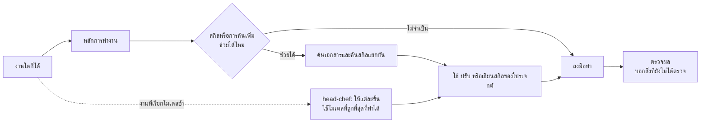

<p align="center">
  
</p>

<h1 align="center">OneForAll</h1>
<p align="center"><a href="README.md">English</a> | <a href="README.th.md">ภาษาไทย</a></p>
<p align="center"><strong>หลักการทำงานชุดเดียวสำหรับทุกงาน สกิลที่เป็นของแต่ละโปรเจกต์ และโมเดลที่เหมาะกับแต่ละขั้น</strong></p>

<p align="center">
  
  
  
</p>

<p align="center">
  <a href="#เริ่มใช้งาน">เริ่มใช้งาน</a> ·
  <a href="docs/setup.th.md">คู่มือติดตั้ง</a> ·
  <a href="skills/oneforall/SKILL.md">ตัวสกิล OneForAll</a> ·
  <a href="skills/head-chef/SKILL.md">ตัวสกิล head-chef</a> ·
  <a href="docs/verification.th.md">ผลทดสอบ</a>
</p>

---

agent เขียนโค้ดเก่งอยู่แล้ว แต่มักเสียแรงไปในแบบเดิม ๆ: สร้างของที่โปรเจกต์มีอยู่แล้วขึ้นมาใหม่ บอกว่า "แก้แล้ว" โดยไม่ได้ตรวจ ไปค้นหาสกิลทั้งที่ไม่จำเป็น และใช้โมเดลแพงที่สุดกับงานที่สคริปต์ทำได้

OneForAll คือ [Agent Skills](https://agentskills.io/specification) สองตัวที่อุดช่องโหว่เหล่านี้ ใช้ได้กับงานในโปรเจกต์ทุกแบบ ทั้งโค้ด เอกสาร วิดีโอ งานออกแบบ ข้อมูล การค้นคว้า และงานระบบ

| สกิล | สิ่งที่ agent ได้ |
| --- | --- |
| **[oneforall](skills/oneforall/SKILL.md)** | **หลักการทำงาน 8 ข้อ** สำหรับทุกงาน และ**การหาสกิลแยกตามโปรเจกต์**: หา ปรับ หรือเขียนสกิลเฉพาะเมื่อมันแก้ปัญหาได้จริง แล้วเก็บไว้ในโปรเจกต์นั้น |
| **[head-chef](skills/head-chef/SKILL.md)** | **การเลือกโมเดล**สำหรับงานที่รันซ้ำ: โมเดลที่เก่งที่สุดเขียนสูตรครั้งเดียว โค้ดและโมเดลที่ถูกกว่าทำงานทุกรอบ และการเปลี่ยนไปใช้โมเดลถูกลงต้องพิสูจน์กับข้อมูลจริงในอดีตก่อน |

ทั้งสองตัวทำงานแยกกัน จะติดตั้งคู่กันหรือตัวเดียวก็ได้

## เริ่มใช้งาน

ต้องมี Node.js/npm และ Git

```sh
# Claude Code และ Codex พร้อมกัน
npx skills add thefogusz/OneForAll --skill oneforall head-chef --agent claude-code codex --global
```

บน Windows PowerShell ถ้าเครื่องปิดการรันสคริปต์ไว้ ให้ใช้ `npx.cmd` แทน จากนั้นสั่งงานได้เลย:

```text
Claude Code: /oneforall แก้ระบบ export ให้รองรับข้อมูลภาษาไทยในโปรเจกต์นี้
Codex:       $oneforall แก้ระบบ export ให้รองรับข้อมูลภาษาไทยในโปรเจกต์นี้
```

ถ้าต้องการให้ agent ใช้ OneForAll เองโดยไม่ต้องสั่ง ให้เพิ่ม[บล็อกคำสั่งอัตโนมัติ](docs/setup.th.md#เปิดโหมดอัตโนมัติ) ลงในไฟล์คำสั่งส่วนตัวครั้งเดียว ส่วนการติดตั้งเฉพาะโปรเจกต์ การติดตั้งด้วยมือ และการใช้กับ agent อื่น ดูได้ใน[คู่มือติดตั้ง](docs/setup.th.md)

## ภาพรวมการทำงาน



ตัวสกิลที่ติดตั้งใช้ร่วมกันทุกโปรเจกต์ แต่สิ่งที่มันเรียนรู้ไม่ปนกัน สกิลของแต่ละโปรเจกต์อยู่ในโฟลเดอร์ `.claude/skills/` หรือ `.agents/skills/` ของโปรเจกต์นั้นเอง

```text
~/.claude/skills/  หรือ  ~/.agents/skills/     ติดตั้งครั้งเดียว ใช้ร่วมกัน
├── oneforall/
└── head-chef/

video-project/.claude/skills/                   เป็นของโปรเจกต์นี้เท่านั้น
├── video-project-catcut-export/
└── video-project-nightly-render/               สูตรจาก head-chef

web-app/.agents/skills/
└── web-app-api-checks/
```

## หลักการทำงาน

งานจริงทุกงานจะทำตามหลักการสั้น ๆ 8 ข้อ ปรับมาจาก [Superpowers](https://github.com/obra/superpowers) และ [Ponytail](https://github.com/dietrichgebert/ponytail):

| # | หลักการ | ในทางปฏิบัติ |
| --- | --- | --- |
| 1 | **เข้าใจก่อนลงมือ** | อ่านส่วนที่งานไปแตะ รวมถึงสกิลของโปรเจกต์ และไล่ให้ครบว่าการแก้ต้องไปถึงที่ไหนบ้าง |
| 2 | **เล็กที่สุดแต่ครบ** | ใช้ของที่มีอยู่ (โค้ด เทมเพลต preset สกิลของโปรเจกต์) ก่อนสร้างใหม่ เล็กไม่ได้แปลว่าทำครึ่งเดียว |
| 3 | **ห้ามตัด** | การตรวจข้อมูล การกันข้อมูลหาย ความปลอดภัย ความเป็นส่วนตัว การเข้าถึง ลิขสิทธิ์ และสิ่งที่คุณสั่ง |
| 4 | **หาต้นเหตุก่อนแก้** | แก้ครั้งเดียวที่ต้นทาง ถ้าแก้สองรอบแล้วไม่หาย ให้ทบทวนใหม่แทนการปะต่อ |
| 5 | **ตรวจสิ่งที่พังได้ และเก็บการตรวจไว้** | logic ที่เกี่ยวกับเงินหรือมีเงื่อนไข ต้องทิ้งไฟล์เทสต์ไว้ แม้โปรเจกต์ยังไม่มีชุดเทสต์ |
| 6 | **ขั้นเล็กที่ตรวจได้** | งานหลายขั้นแบ่งเป็นขั้นที่แต่ละขั้นจบด้วยการตรวจ |
| 7 | **มีหลักฐานก่อนบอกว่าเสร็จ** | บอกว่า "เสร็จ" ได้หลังรันตรวจในรอบนี้แล้วเท่านั้น และบอกชัดว่าอะไรยังไม่ได้ตรวจ |
| 8 | **ทำเครื่องหมายทางลัด** | ระบุข้อจำกัดและเวลาที่ควรกลับมาแก้ |

การตรวจแต่ละแบบขึ้นกับประเภทงาน: โค้ดใช้เทสต์ เอกสารต้องรันทุกคำสั่งที่เขียนไว้ วิดีโอต้องเปิดดูภาพที่ render แล้ว ข้อมูลต้องกระทบยอดกับต้นทาง การค้นคว้าต้องเปิดแหล่งต้นทางจริง ตารางเต็มอยู่ใน[ตัวสกิล](skills/oneforall/SKILL.md#work-principles-for-every-task)

ถ้าใช้ Superpowers หรือ Ponytail อยู่แล้ว สกิลเต็มของมันยังใช้ได้ และกฎที่เข้มกว่าเป็นฝ่ายชนะ ดู[ส่วนที่นำมาจากแต่ละตัวและเหตุผล](skills/oneforall/references/work-principles.md)

## สกิลของโปรเจกต์ สร้างเมื่อคุ้มเท่านั้น

ปัญหาที่คุณเจออาจมีคนเขียนสกิลไว้แล้ว OneForAll จะไปค้นเฉพาะตอนที่ช่วยได้จริง เช่น เครื่องมือที่ยังไม่คุ้น งานที่ต้องทำด้วยมือซ้ำ ๆ หรือปัญหาที่แก้หลายรอบแล้วยังไม่หาย ส่วนงานทั่วไปจะลงมือทำเลย

เมื่อควรค้น จะค้นสองทางแยกกัน:

- **ค้นข้อมูลเทคนิค:** จากเอกสารต้นทาง แล้วเทียบกับเวอร์ชันและเครื่องมือที่โปรเจกต์ใช้จริง
- **ค้นสกิล:** จากสกิลในเครื่อง [skills.sh](https://skills.sh/) และ repo ต้นทาง โดยอ่านเนื้อหาจริงก่อนเลือก

ถ้ามีสกิลที่ตรงงานก็ใช้ตามนั้น ถ้าไม่มี OneForAll จะเขียนสกิลสั้น ๆ ของโปรเจกต์จากสิ่งที่ค้นได้ แต่ต้องระบุก่อนว่าสกิลนั้นป้องกันปัญหาอะไร และต้องตรวจความถูกต้องของไฟล์ก่อนรายงาน สกิลภายนอกจะเสนอให้คุณเลือกเท่านั้น ไม่ติดตั้งเอง สกิลที่ OneForAll ดูแลจะมี `metadata.oneforall-managed: "true"` ส่วนสกิลที่คุณเขียนเองจะไม่ถูกแตะ

## head-chef: โมเดลที่เหมาะกับแต่ละขั้น

สำหรับงานที่เรียกโมเดลซ้ำ ๆ เช่น งานตั้งเวลา pipeline หรือ workflow หลาย agent:

```text
โค้ด  →  classifier (ถ้ามี)  →  โมเดลเล็ก  →  โมเดลกลาง  →  โมเดลใหญ่
          หยุดที่ตัวแรกที่ทำขั้นนั้นได้
```

- **ไม่ระบุชื่อโมเดลตายตัว:** อ่านรายการโมเดลที่ host มีตอนนั้น เรียงตามราคาและตำแหน่งที่ผู้ผลิตวางไว้ แล้วแบ่งระดับ จึงใช้ได้ต่อแม้ Claude หรือ Codex จะออกโมเดลใหม่
- **พิสูจน์ก่อนลดชั้น:** โมเดลที่ถูกกว่าจะรับงานขั้นใดได้ ต้องผ่านการทดสอบกับข้อมูลจริงในอดีต ให้ได้ผลสม่ำเสมอเทียบเท่าโมเดลเดิม
- **มีราวกันตก:** เพดานงบ สวิตช์ปิดฉุกเฉิน บันทึกการส่งต่อ และสุ่มตรวจทุกสัปดาห์หลังใช้งานจริง
- **มีผู้ตรวจอิสระ:** เช็กว่า CLI ของอีกค่าย (Codex หรือ Claude Code) ติดตั้งและล็อกอินไว้หรือยัง แล้วเสนอให้ใช้ ถ้าไม่มีจะสร้าง agent ตัวใหม่ที่เห็นเฉพาะผลงานกับเกณฑ์ตรวจมาทำหน้าที่ตรวจแทน

## ทดสอบกับงาน 6 ประเภท

ให้ agent ที่ไม่ได้รู้มาก่อนว่ากำลังถูกทดสอบเรื่องอะไร ใช้ทั้งสองสกิลทำงานที่มีกับดักซ่อนไว้ วันที่ 2026-10-29:

| งาน | กับดัก | ผล |
| --- | --- | --- |
| แก้บั๊กโค้ด | ส่วนลดคิดผิด และมีผู้เรียกใช้สองที่ | ✅ แก้ครั้งเดียวที่ฟังก์ชันกลาง มีไฟล์เทสต์ที่เห็นทั้งตอนตกและตอนผ่าน *(รอบสอง หลังแก้สกิล)* |
| เอกสาร | ชื่อสคริปต์เก่าซ้ำอยู่ใน FAQ | ✅ แก้ครบทั้งสองที่ และรันคำสั่งตามเอกสารจริง |
| วิดีโอ | brief ให้ตัดทีเซอร์ 6 วินาที 720p | ✅ ไม่แตะไฟล์ต้นฉบับ ตรวจความยาว ขนาด และเสียง และเปิดดูภาพจริง *(รอบสอง)* |
| ข้อมูล | order ซ้ำหนึ่งรายการและยอดว่างหนึ่งช่อง | ✅ เจอทั้งสองจุด บอกผลต่อยอดรวม และไม่ใช้โมเดลคิดตัวเลข |
| คำถามสั้น ๆ | "โปรเจกต์นี้ทำอะไร" | ✅ ตอบตรง ๆ ไม่สร้างไฟล์ ไม่ค้น ไม่พูดเรื่องสกิล |
| งานที่รันซ้ำ | digest รายคืนที่ส่งทุกอย่างให้โมเดลแพงสุด | ✅ ออกแบบให้โค้ดทำก่อน มีเพดานงบ สวิตช์ปิด และแผน replay ไฟล์สกิลผ่านการตรวจ *(รอบสอง)* |

รอบแรกเจอจุดอ่อน 4 จุด: ไม่ทิ้งเทสต์ไว้ ไม่ได้เปิดดูภาพ ไฟล์สกิลไม่ผ่านการตรวจ และหารายการโมเดลไม่ได้ ทั้ง 4 จุดได้รับการแก้ในตัวสกิล แล้วรันงานเหล่านั้นซ้ำ รายละเอียดและข้อจำกัดอยู่ใน[ผลทดสอบ](docs/verification.th.md)

## การรองรับ

| Agent | สถานะ |
| --- | --- |
| Claude Code | ทดสอบการติดตั้งแล้ว และให้ agent ทำตามสกิลกับงาน 6 ประเภทแล้ว ยังไม่ได้ดูการเรียกใช้อัตโนมัติแบบครบวงจร |
| Codex | ทดสอบการติดตั้งและโจทย์ตัวอย่างแล้ว |
| Agent อื่นที่รองรับ Agent Skills | มีแนวทางเรื่องตำแหน่งไฟล์และวิธีเรียก ยังไม่ได้ทดสอบ |

ไม่ต้องเปิดบริการเบื้องหลังหรือสมัคร API เพิ่ม การค้นใช้เครื่องมือเว็บที่ agent มีอยู่ ถ้าใช้ไม่ได้ agent จะแจ้งตามจริงและทำงานจากข้อมูลที่ตรวจสอบได้เท่านั้น

## เครดิต

หลักการทำงานปรับมาจาก [Superpowers](https://github.com/obra/superpowers) ของ Jesse Vincent และ [Ponytail](https://github.com/dietrichgebert/ponytail) ของ DietrichGebert (ทั้งคู่เป็น MIT) การค้นสกิลได้แนวคิดจาก [Vercel find-skills](https://github.com/vercel-labs/skills/blob/main/skills/find-skills/SKILL.md) และ [AutoSkill](https://github.com/ECNU-ICALK/AutoSkill) การเขียนสกิลอิงแนวทางของ [OpenAI](https://github.com/openai/skills) และ [Anthropic](https://github.com/anthropics/skills/blob/main/skills/skill-creator/SKILL.md) ไม่จำเป็นต้องติดตั้งโครงการใดเหล่านี้ ดู[แหล่งอ้างอิง](skills/oneforall/references/research-sources.md) ส่วนโลโก้สร้างด้วย AI

## แจ้งปัญหา

ถ้าสกิลทำงานผิดจังหวะ สร้างสกิลซ้ำ หรือเก็บวิธีที่ใช้ไม่ได้ ช่วย[เปิด issue](https://github.com/thefogusz/OneForAll/issues) พร้อมงานที่สั่ง agent ที่ใช้ และผลที่เกิดขึ้น โดยลบข้อมูลส่วนตัวออกก่อน
